# 交付预览 / Deliverable Showcase

所有资产均由 `output/` 下的管线真实生成（Godot 真值渲染 + 本机 NewAPI → Gemini 图像模型 +
确定性像素后处理）。验收采用独立多模态 subagent 的 100% 资产覆盖审查，不使用代码单元测试。

---

## 0. 本批次：角色 `agent`

### 0.1 设定图 / 武器零件

| | |
|---|---|
| 全身立绘 + 刀/鞘/枪零件 | 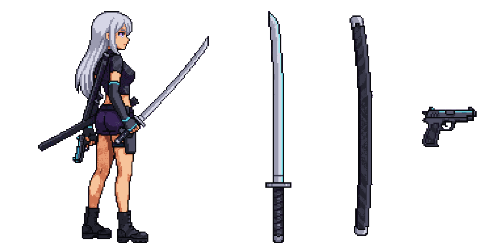 |
| 64px 真像素母版 16× | 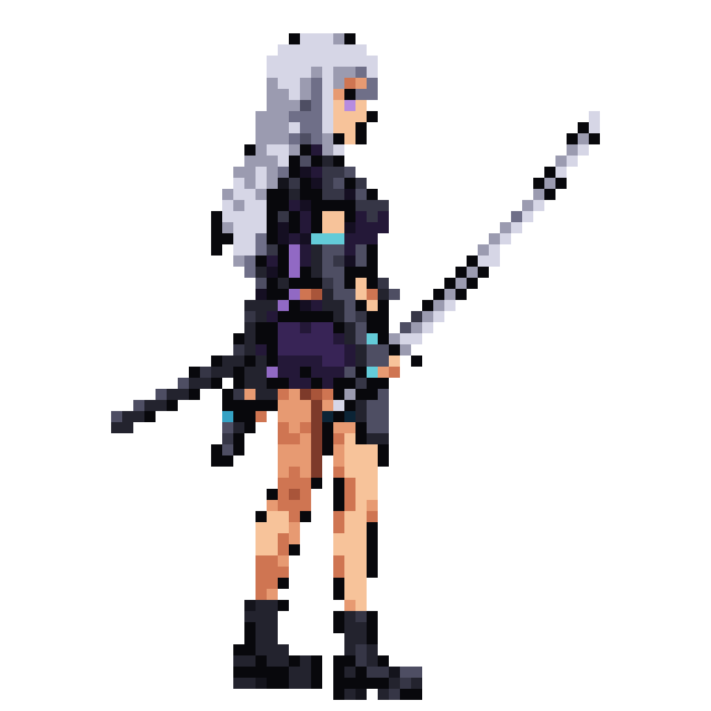 |
| 武士刀零件 | 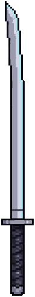 |
| 空刀鞘零件 | 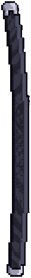 |
| 手枪零件 | 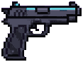 |

### 0.2 动作（预览 4 + run 锚点）

| 动作 | 8 帧 8× 表 | 512px 单帧播放 |
|---|---|---|
| Idle | 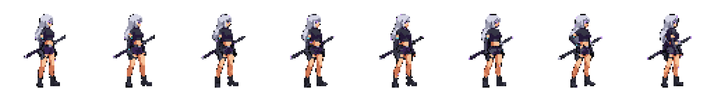 | 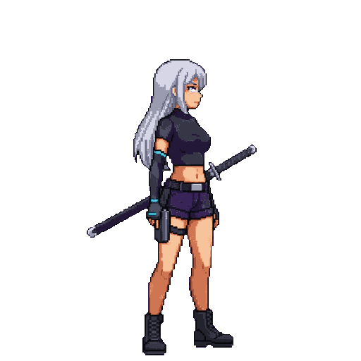 |
| Run | 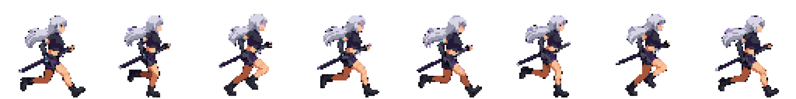 | 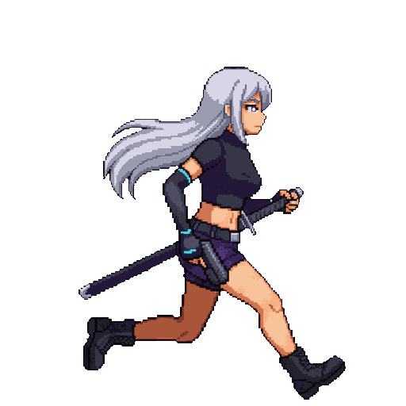 |
| Slash2（跑动挥刀） | 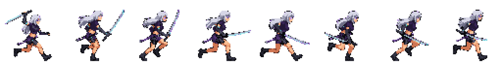 | 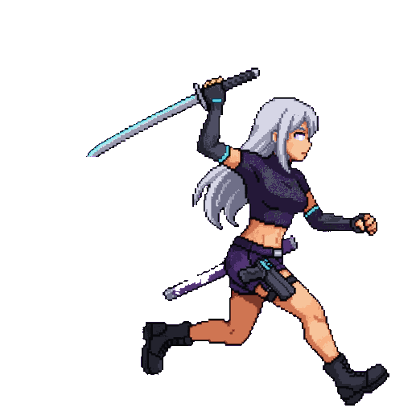 |
| Shoot2（跑动开枪） | 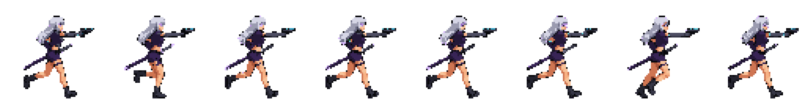 | 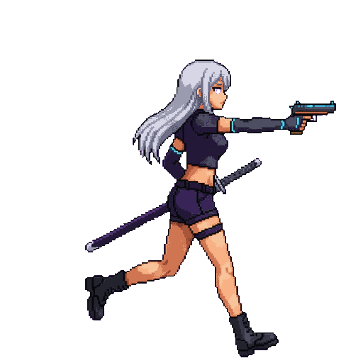 |
| Roll（前滚翻） | 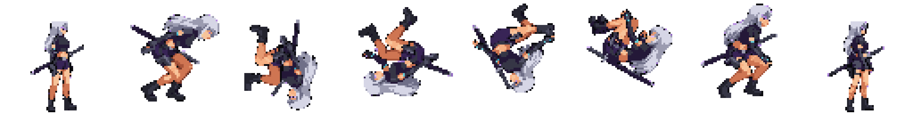 | 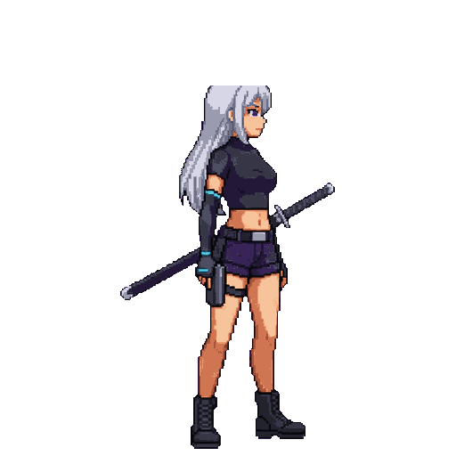 |

- 64px 游戏帧另有 4× 播放：同目录 `preview.png` / `preview.gif`。
- 衔接锚点：`slash2` / `shoot2` 首末帧 = `run:0` / `run:7`；`roll` 首末帧 =
  `idle:0` / `idle:7`；`run` 自循环。SHA-256 见 `character/agent/transitions.json`。
- `roll` 的 3D 真值是“首末帧 Idle + 中间六帧团身”并叠加整副骨架 360° 俯仰，
  不是让图像模型凭空画一个球。

---

## 1. 本批次：飞船内景 `ship`

| | |
|---|---|
| Tile 图集（25 张） |  |
| Tile 拼合样例 |  |
| 中型结构（3/10） |  |
| Mega 元素（3/20） |  |
| 整船内景（mega 装配） |  |
| 综合场景 |  |

- 已生成中型结构：`console_bank`、`cargo_stack`、`server_rack`。
- 已生成 Mega 元素：`hull_frame`、`viewport`、`reactor_core`。
- 其余 7 种中型、17 种 mega 已在 `config/ship_config.py` 定义，等待风格确认后批量生成。
- 整艘飞船本身作为一个 mega 装配：48×20 格（1536×640）。
- 全部 tile / 结构 / 场景通过调色板锁与硬 Alpha；四张基础材质均通过 full-sample + 3×3 双 KS。

---

## 2. 原有 `knight` 动作（保持兼容）

| | |
|---|---|
| 母版立绘 |  |
| Idle |  |
| Running |  |
| Attack |  |
| Defend |  |
| Jump |  |
| In Air |  |

动作映射：`idle→Idle`、`running→Running_A`、`attack→1H_Melee_Attack_Chop`、
`defend→Blocking`、`jump→Jump_Start`、`in_air→Jump_Full_Short [0.35, 0.68]`。

---

## 3. 原有 `field` 地形 / 中型 / 巨构（保持兼容）

| | |
|---|---|
| 完整地形 |  |
| 中型巨构 |  |
| 超大型巨构 |  |
| 综合场景 |  |

47-Tile 过渡、环面无缝、九宫格巨构装配与 Tiled 导出的细节见
`environment/field/REPORT.md` 与 `mega/field/report.json`。

---

## 4. 独立多模态审查

- 角色 100% 覆盖包：`work/review/character/`（全部 8 帧 × 512px / 64px / 3D 真值、
  跨动作、衔接、run 循环、锚点差分）。
- 环境 100% 覆盖包：`work/review/ship/`（25 tile 全图、3 中型、3 mega、整船、showcase）。
- 报告（每轮保留）：`output/reviews/character_review_v1..v4.md`、
  `output/reviews/ship_review_v1..v5.md`。
- 审查模型：`dawnfm/deepseek-v4.1-flash-1017`，effort high，独立 subagent。
- 这是预览批次：先确认风格/正确性，再扩展到完整 10 中型 / 20 mega / 全部角色动作。
- 当前状态：**环境 v5 = PASS**（无 BLOCKER/MAJOR，仅 polish）；
  **角色 v4 = FAIL**（背刀重复/拆分、slash2 f1 裸柄 + f6 双刀、紫瞳只在 idle、
  刀长/厚度不一致、run 不换腿、roll 背刀穿过头发/64px 难读；另有 512/64 仍为两张画、
  shoot2 f1 手枪不可读）。
- 最终验收员 `acceptance-v1`（max）总体判定 **FAIL**：报告
  `output/reviews/acceptance_v1.md`。验收后已修 ship 的 window/贴花、server 透明缺口、
  reactor 底座、角色悬停/矩形阴影、双角色克隆；角色本体仍留给下一轮部件级合成。
- 最新报告：`output/reviews/ship_review_v5.md`、`output/reviews/character_review_v4.md`、
  `output/reviews/acceptance_v1.md`。
