# 交付预览 / Deliverable Showcase

所有资产均由 `output/` 下的管线真实生成（Godot 真值渲染 + 本机 NewAPI → Gemini 图像模型 + 确定性像素后处理），并已逐张目视核对。

---

## 0. 本轮预览：ship 飞船内景

### 0.1 Ship 环境

| | |
|---|---|
| Tile 图集（22 张） | 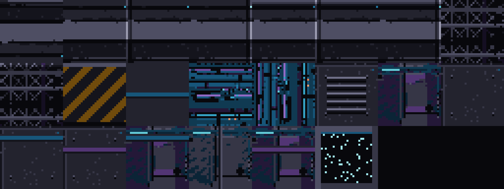 |
| Tile 拼合样例 | 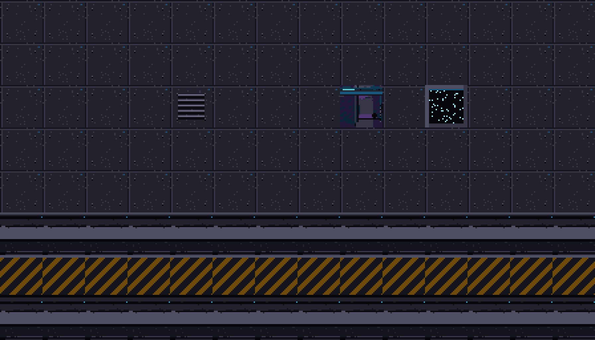 |
| 中型结构（3/10） | 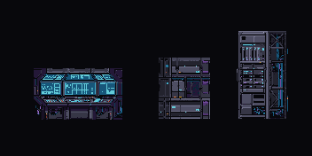 |
| Mega 元素（3/20） | 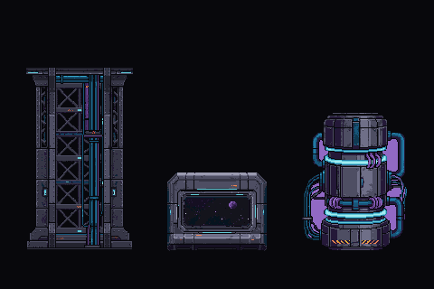 |
| 整船内景（mega 装配） | 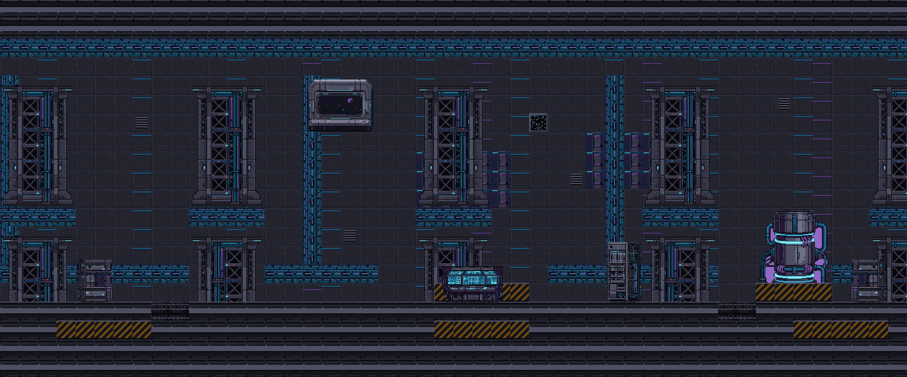 |
| 综合场景 | 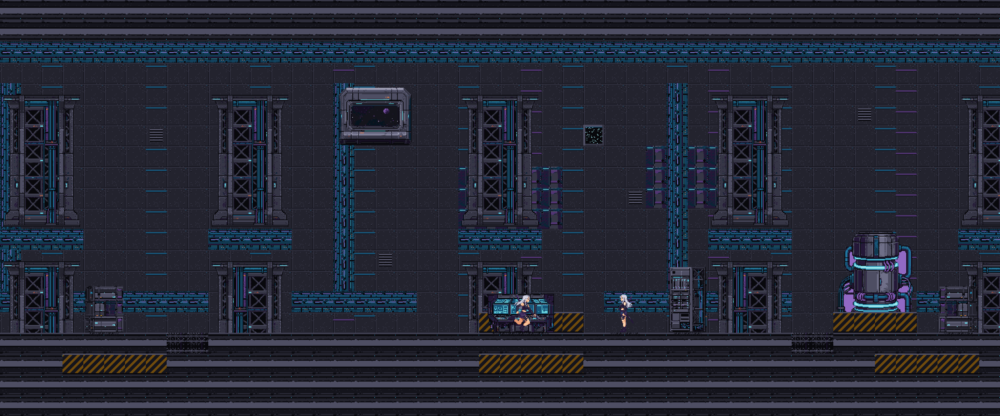 |

- 已生成中型结构：`console_bank`、`cargo_stack`、`server_rack`。
- 已生成 Mega 元素：`hull_frame`、`viewport`、`reactor_core`。
- 其余 7 种中型、17 种 mega 已在 `config/ship_config.py` 定义，等待风格确认后批量生成。
- 全部 tile / 结构 / 场景通过调色板锁与硬 Alpha；四张基础材质均通过 full-sample + 3×3 双 KS。

---

## 1. 角色动作（模块一）

| | |
|---|---|
| 母版立绘（64×64 真像素） | 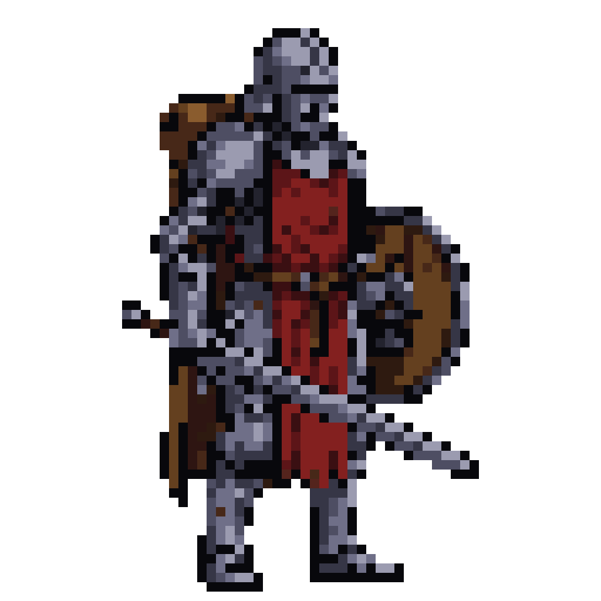 |
| Idle | 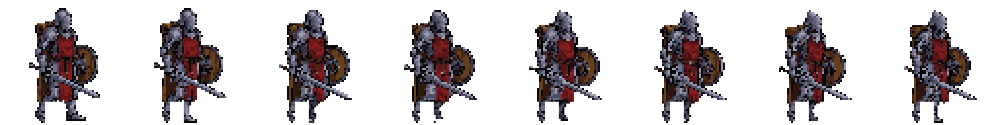 |
| Running | 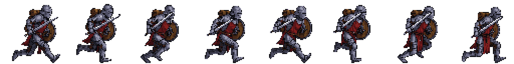 |
| Attack（劈砍） | 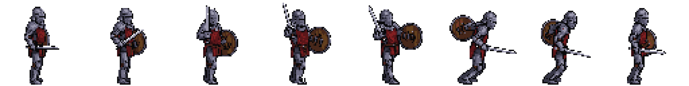 |
| Defend（格挡） | 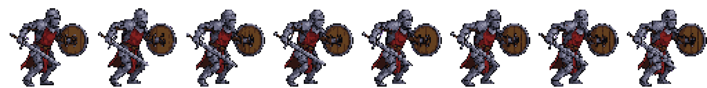 |
| Jump（起跳） | 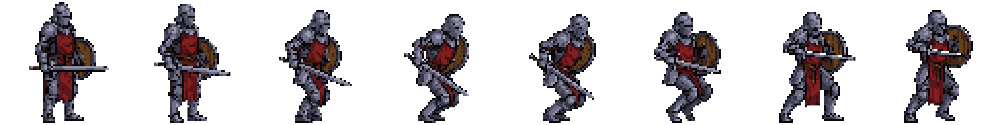 |
| In Air（空中） | 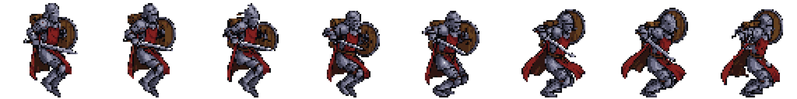 |

**连续播放**（APNG，浏览器/图片查看器直接播放；同目录另有 GIF）：

| 动作 | 播放 |
|---|---|
| Idle | 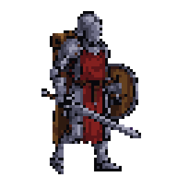 |
| Running | 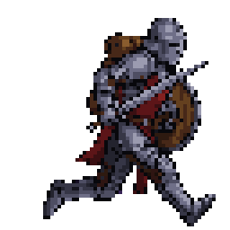 |
| Attack | 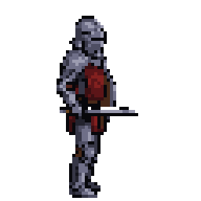 |
| Defend | 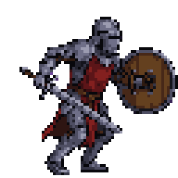 |
| Jump | 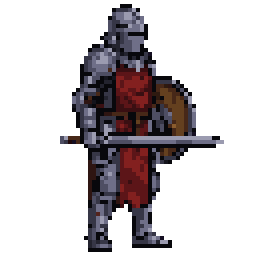 |
| In Air | 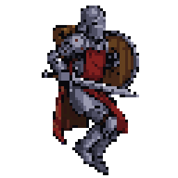 |

动作映射（KayKit 76 clips，CC0）：`idle→Idle`、`running→Running_A`、`attack→1H_Melee_Attack_Chop`、`defend→Blocking`、`jump→Jump_Start`、`in_air→Jump_Full_Short [0.35, 0.68]`（取整个跳跃的滞空段，而不是起跳/落地）。

> 两个关键修正：
> - **相机**：`(-70, 37, 20)`，约 74° 的近侧视，从角色右侧（剑侧）看；剑臂在近景，盾在远侧。原来的 55° 视角下剑只刚过身体，容易被读成盾击。
> - **武器挂点**：剑必须继承 KayKit `1H_Sword` 相对 `hand.r` 的真实朝向；之前把剑强制成世界竖直，导致 `Chop` 的劈砍被投影成侧向动作。修正后由 3D 轨迹审计自动选择 clip。

**跨动作一致性**：3×3 复合板的 Panel 0 使用 **全分辨率参考图** `work/character/knight/char_ref_canvas.png`（512，75° 右近侧视提示），不再用 64px 像素化母版放大；同一把剑的宽度、盾面纹样、头盔/面甲细节在六个动作中保持一致。

**验收数据**（`character/knight/*/report.json`）：

| 动作 | 帧数 | 静止差分（opaque） | 全特征审计 |
|---|---|---|---|
| idle | 8 | 701 次检查，350 → **0** | 350 次，drift 0 / missing 2（靴缝切开后少量 1px 高光） |
| defend | 8 | 613 次，320 → **0** | 339 次，drift 0 / missing 0 |
| in_air | 8 | 999 次，720 → **0** | 348 次，drift 89 / missing 66（信息列） |
| running | 8 | 15 次，9 → **0** | 信息统计 |
| attack | 8 | 89 次，73 → **0** | 信息统计 |
| jump | 8 | 22 次，18 → **0** | 信息统计 |

- 所有帧与 `sheet.png` / `sheet_1x.png`：`0` 个半透明像素，`0` 个非调色板像素（含透明像素 RGB）；defend 的粉色背景连通块、in_air 的孤立碎片与 idle 的 11px 脚后碎片已在最终帧守卫中清除（每帧仅 1 个 alpha 连通块）。
- idle 的 3D 仿射交叉核对：322 次，drift 42 / missing 1；defend：346 次，drift 48 / missing 0（信息列）。
- 参考面板锁定差异 **0**（`lock_reference_panel` 逐像素回填）。

---

## 2. 环境材质与完整地形（模块二）

| | |
|---|---|
| 草地 3×3 | 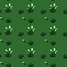 |
| 泥土 3×3 | 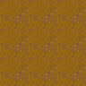 |
| 青石 3×3 | 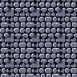 |
| 深水 3×3 | 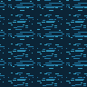 |
| 47-Tile 草→土 | 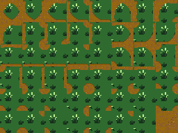 |

- 2×2 同步板确定世界色温/光照；草/土/石在 **32×32 设计尺度**生成，水改为 **同向 1px 细浪**（短断线、无圆圈、无同心环、无大浪），不再是波纹圆圈阵列或海面大波。
- 草：干净绿底 + 4 个 4–5px 的可读草簇 + 3 个小暗簇（去掉孤立 1px 噪点）；土：暖棕底 + 细碎斑与 1–2px 卵石（无灰色矩形、无大暗纹）；石：蓝灰圆石 + 深灰缝。
- 无缝：环面平移 + 保护外框十字掩膜；草/水使用 2px 邻域调色板中值（`seam_median`），土用 Gemini inpaint，石也用中值；同时对亮/暗/均匀的“烤进十字”做拒绝，避免出现整块白色十字。
- 交付砖 dual KS 全过：grass 1.0/1.0、dirt 1.0/1.0、stone 1.0/0.9987、water 1.0/1.0。

**完整地形拼合预览**（草/土/石/水全部走 47-Tile 过渡；水塘有土岸，不再是硬矩形）：


**动态地形预览**（草地 4 帧摆动；水面使用统一的静态基准砖，不再让动画帧和岸边 atlas 变成两种水）：

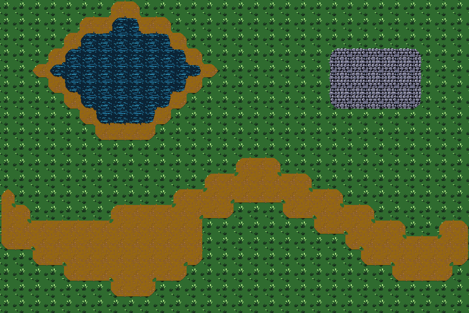

- 生成 `autotile_{grass,dirt,stone,water}_over_{dirt,grass}` 六套 47-Tile 图集；草-土道路/空地、草-石平台、水-土岸、水-草边界均有独立过渡。
- 水面使用 `water_seamless.png` 的直接平铺 + 水-土岸 47-Tile；3×3 平铺无可见方格或圆圈阵列。
- 每个地形内部：草为可读草簇、土为无矩形暖棕、水为同向细浪、石为圆石；32px 周期重复仍在，但没有明显接缝。
- 草地/土路的转角：47-Tile 的连通边钉边放在对角凹口之前，转角只保留 1px 对角凹口（不再 4px 内缩），既消除之前每个草角多出的土三角，也不再切出可见的绿色方缺口。
- 水/土岸：3 水 + 1 陆的凹角不再切 `concave_notch`（旧版正是这个切角让陆地朝水里伸出 3px 三角），并用 1 个水色 marker 让 47 个对角状态仍然唯一。水塘内部、water-over-dirt 岸砖、静态水砖三处共用同一张 `water_seamless.png`，不再出现“中间一种水、岸边另一种水”。

**动态材质**（4 帧循环；每帧 32×32、调色板纯净；APNG/GIF 可直接播放）：

- 水面动画（独立资产 `water_anim/`，不参与地形拼合）不是整图 1px 平移：4 帧来自 Gemini 的 2×2 连续动画表，先匹配静态水砖的深蓝调色板，再逐帧走保护外框的 seam 修复。4 帧 dual KS 全过（p 0.895–0.995）；循环差 9.51（相邻差 17.24 / 17.33 / 14.51，循环段最小）；最佳刚性 roll 残差 8.2–9.9，明显低于实际帧差 14.5–17.3，说明它不是纯平移。

| 水面 | 草地 |
|---|---|
| 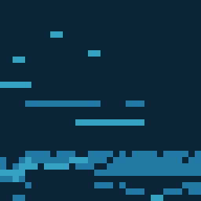 | 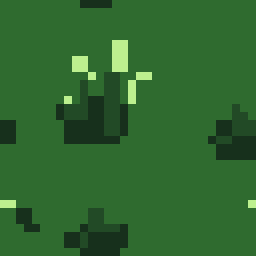 |

---

## 3. 中型巨构（模块三）

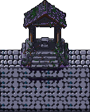

4×5 格接地画布（API 以 **4:5** 请求，不再纵向拉伸）→ Gemini 生成 → 洋红/地面差异抠图 → 20 张 32×32 子图块 + `stamp_metadata.json`（底部 2 行 `sorted_body` / 上部 3 行 `overhead_canopy`，全局 Y-Sort 锚点 `pivot={64,160}`）。

接地处理：差异抠图保留 AI 的中央石阶/树根与接地阴影；两侧碎石噪点清理后用 AI 自身底部色带的中值纹理补齐，再把中央基座像素逐像素贴回。地面砖优先使用 **模块二 `stone_seamless.png`**，与地形同源。

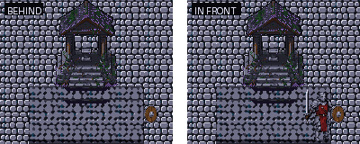

Y-Sort 演示使用真实 knight 精灵：左图角色站在建筑后侧，门廊/基座遮住其左侧身体；右图同一位置改为“角色在前”，完整覆盖建筑。

---

## 4. 超大型巨构（模块四）

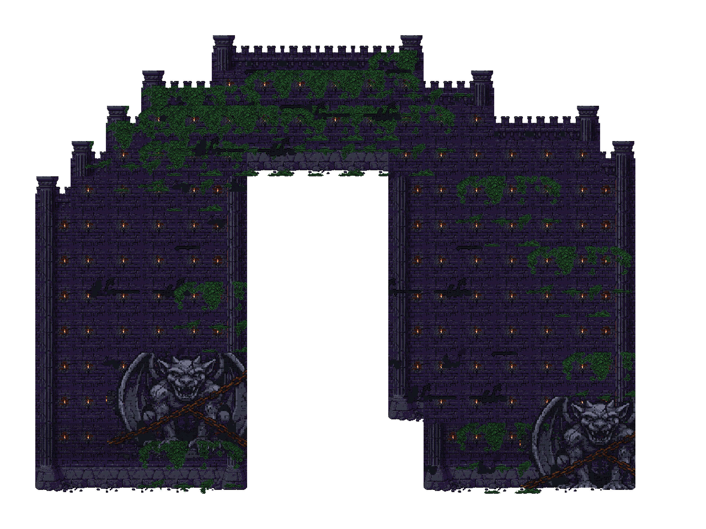

20×15 大砖（64×64）九宫格装配：图着色中心变体、跨格贴花、宏观 AO、32px 图集去重。

**验收数据**（`mega/report.json`）：

- 唯一 32px 图块：**415**（图集 `mega_atlas.png`，13280×32）。
- 水平/垂直相邻相同内部砖：**0**。
- 跨网格贴花覆盖率：**51.2%**（任意 alpha）/ **35.8%**（≥10px 严格口径），共 123 个内部交点。
- Tiled 同步：`mega_map.tmj`（tilecount=415、columns=415、1200 格布局与图集逐砖一致）。
- 调色板纯净度：**0** 违规。

---

## 5. 综合场景

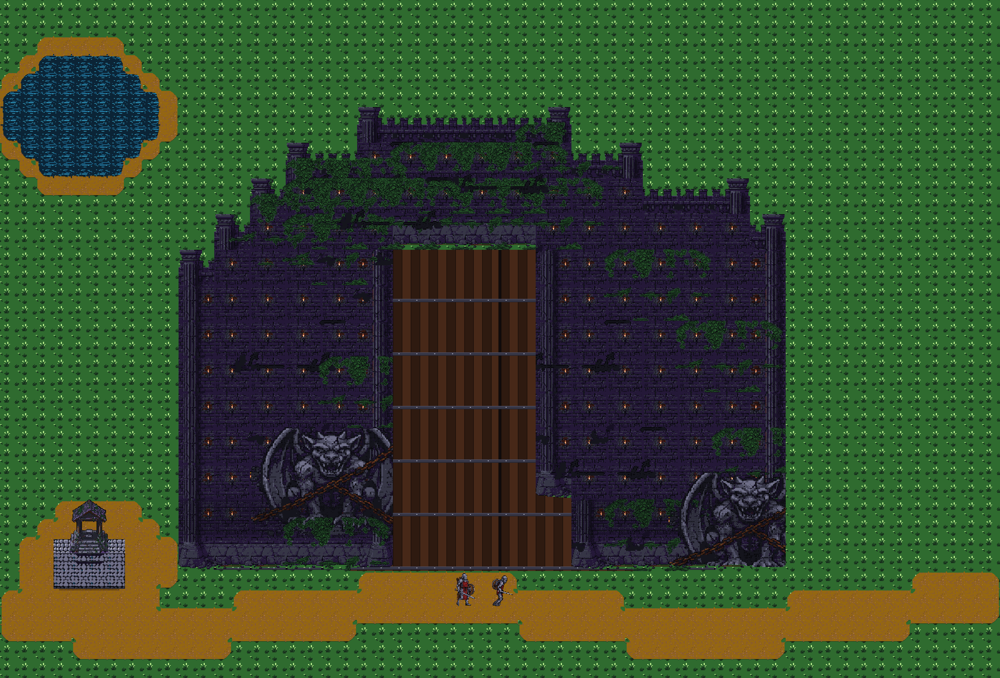

场景为 1792×1216（2× 预览 3584×2432）；巨构使用 `mega_canvas_1x` **1×** 贴入（20×15 个 64px 大砖，底边坐在道路上）；水塘走 water-over-dirt 47-Tile，草地/土路走 47-Tile；场景内的门洞用确定性木门 + 铁箍填满。

> 说明：视觉审查仍将综合场景标为 **FAIL**（巨构 9-slice 门洞/墙缝在像素级拼接下仍有重复与错位）；角色与环境两项均为 **PASS**。

---

## 6. 美术 Agent（判断与审查）

本项目交付的不只是资产，还包括做判断的 agent：

- `agent/motion_audit.py`：从 Godot 读取剑尖/双手/盾牌/髋部的 3D 轨迹，按前向/垂直/横向位移分类并选 attack clip；同时检查相机是否在剑侧（`sword_near_fraction`）。
- `agent/visual_review.py`：把动作表/地形/场景发给本机 NewAPI 的视觉模型，按严格 JSON rubric 审核朝向、语义、粉色块、碎片、接缝、水波方向与落地。
- `agent/orchestrator.py`：串起 motion audit、visual review、调色板纯净度与 `pytest`，写 `output/AGENT_RUN.md`；本次结论为角色 **PASS**、环境 **PASS**、综合场景 **FAIL**（已知巨构拼接弱项）、纯净度/测试 **PASS**。

复现：

```bash
.venv/bin/python -m agent.orchestrator --verify
```
